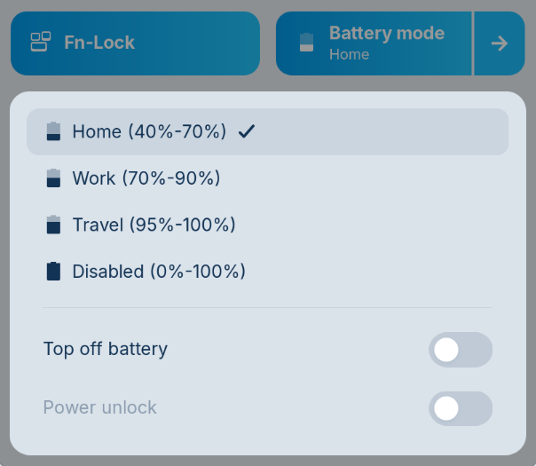

# Huawei WMI controls (GNOME extension)

### Control various Huawei and Honor laptops WMI functions, such as battery protection, Fn-lock, power unlock and keyboard backlight.

Relies on [aymanbagabas/Huawei-WMI](https://github.com/aymanbagabas/Huawei-WMI) kernel module along with [qu1x/huawei-wmi](https://github.com/qu1x/huawei-wmi) to use the WMI interface.

The controls are available in GNOME Quick Settings: Fn-Lock is a standalone tile and battery protection modes are available from the expandable battery mode tile. Either tile can be hidden from the extension preferences.
